# CHRISTIAN WIJAYA — Luxury Fashion

### CW / PREMIUM · an Indonesian-market e-commerce front-end prototype

> **Live Demo — Coming Soon**
> *(Deployment URL to be added once the site is published.)*

A complete, dependency-free storefront for a fictional Bandung fashion house and its first product line — built as the artefact for a Human–Computer Interaction assignment. Ten pages, a sixteen-piece catalogue, and a checkout that behaves the way an Indonesian shopper expects: prices in Rupiah, a separate dialling code beside the national phone number, and five locally familiar payment methods.

Everything here is plain HTML, CSS and JavaScript. There is no framework, no build step, no package manager, no backend, and no dependency of any kind.

---

## Table of contents

1. [Project overview](#1-project-overview)
2. [Project preview](#2-project-preview)
3. [Project objectives](#3-project-objectives)
4. [Features](#4-features)
5. [Pages and navigation](#5-pages-and-navigation)
6. [Technology stack](#6-technology-stack)
7. [Project architecture](#7-project-architecture)
8. [Folder structure](#8-folder-structure)
9. [Installation and local setup](#9-installation-and-local-setup)
10. [Testing and quality assurance](#10-testing-and-quality-assurance)
11. [Responsive testing evidence](#11-responsive-testing-evidence)
12. [Known limitations](#12-known-limitations)
13. [Payment simulation disclaimer](#13-payment-simulation-disclaimer)
14. [Image and font credits](#14-image-and-font-credits)
15. [Future improvements](#15-future-improvements)
16. [License status](#16-license-status)
17. [Author information](#17-author-information)

---

## 1. Project overview

**CHRISTIAN WIJAYA** is a fictional fashion house founded in 2016 in Bandung. **CW / PREMIUM** is its first line — a small run of tailoring, leather and fine jewellery.

The interesting design problem was not the catalogue. It was the **market**. Indonesia is the primary market, and that single decision propagates through the whole system:

- Money is **Indonesian Rupiah**, formatted with Indonesian grouping (`Rp 385.000`), never mixed with `$` or `USD` anywhere on the site.
- The **default country is Indonesia (+62)**, and the checkout shows the dialling code in a **separate chip** from the national phone field, so a user types `81919999` rather than `+6281919999`.
- **Payment follows the region.** Indonesia gets Credit/Debit Card (Visa, Mastercard, **GPN**), Bank Transfer / Virtual Account across 14 banks, **QRIS**, Digital Wallet (GoPay, DANA, OVO, LinkAja) and **Cash on Delivery**. Choosing a different country re-derives the method set, the card networks and the wallets — Singapore, for example, drops QRIS and COD.

The house-and-line structure is **data, not markup**. Products carry `brand: 'CW / PREMIUM'`; the site explains the architecture on its own Collections page.

---

## 2. Project preview

All screenshots are real browser captures of the running site, taken with Google Chrome 157. Every file is listed in [`screenshots/MANIFEST.md`](screenshots/MANIFEST.md) with its size and SHA-256 hash.

### Home

| Desktop — 1440 × 900 | Mobile — 390 × 844 |
|---|---|
| 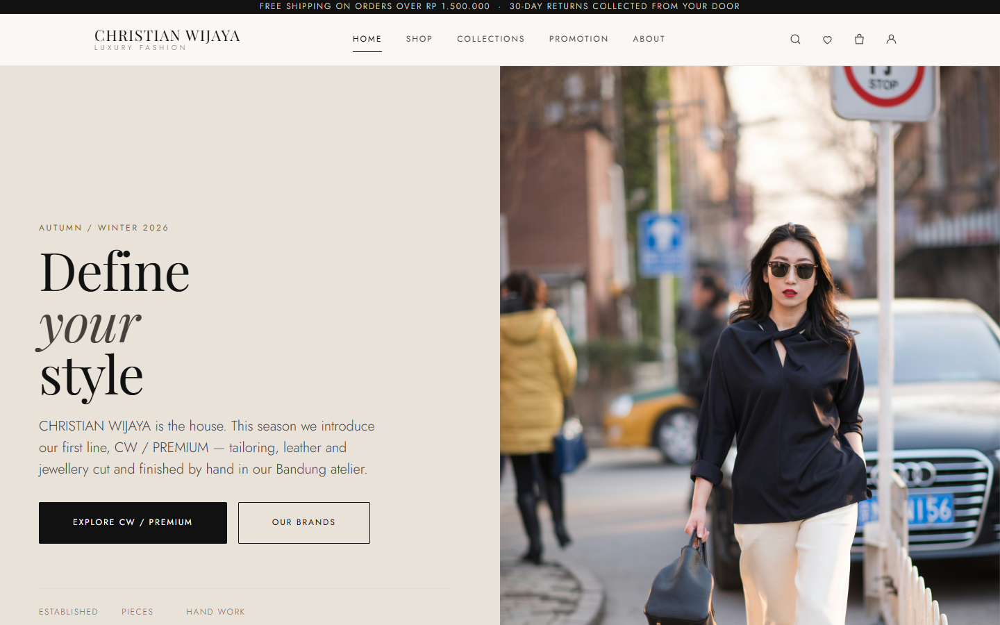 | 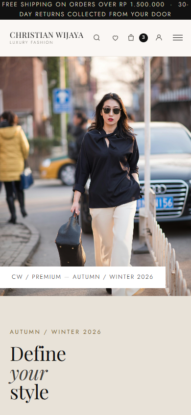 |

### Shop

| Desktop — 1440 × 900 | Tablet — 834 × 1112 | Mobile — 390 × 844 |
|---|---|---|
| 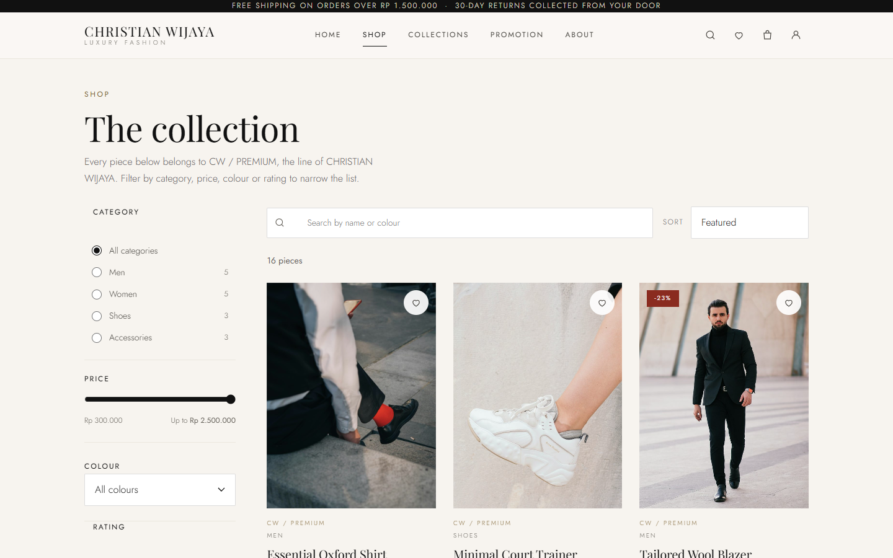 | 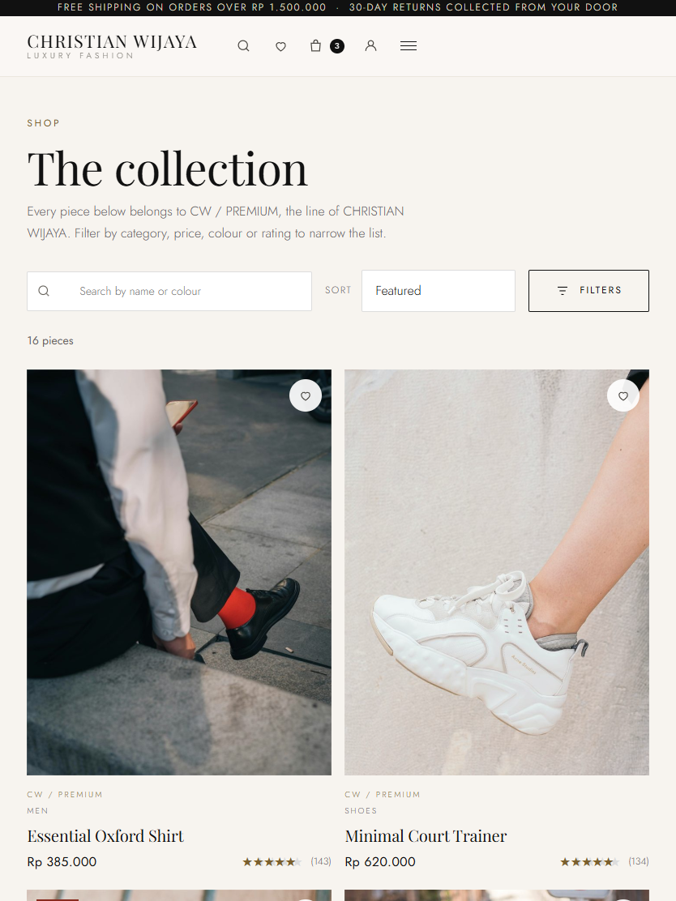 | 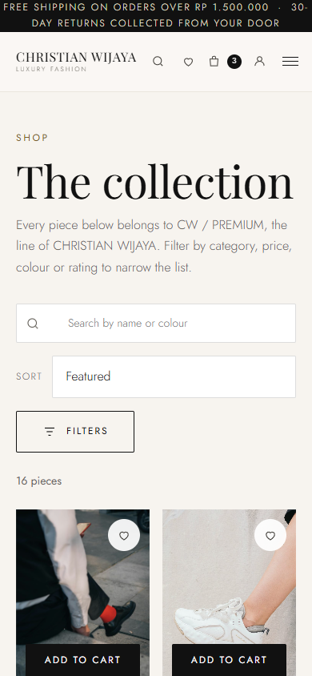 |

### Product detail

| Desktop — 1440 × 900 | Tablet — 834 × 1112 | Mobile — 390 × 844 |
|---|---|---|
| 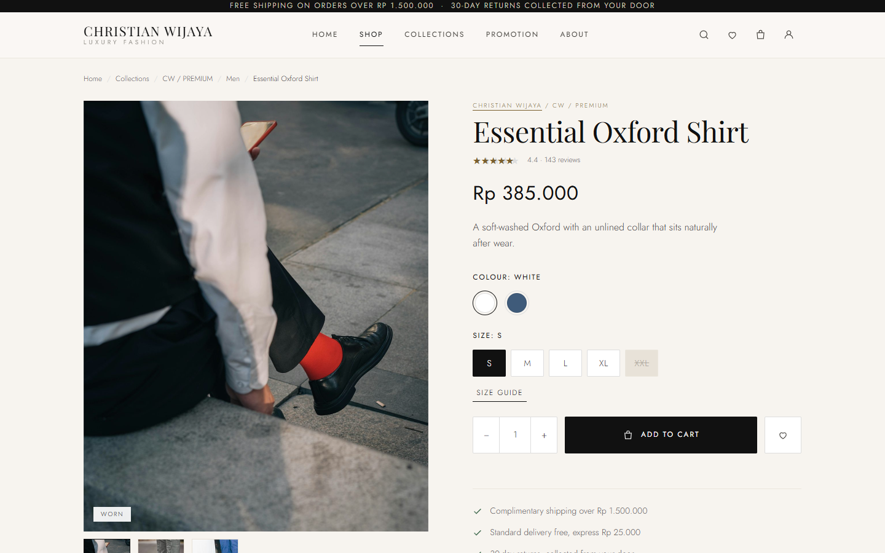 | 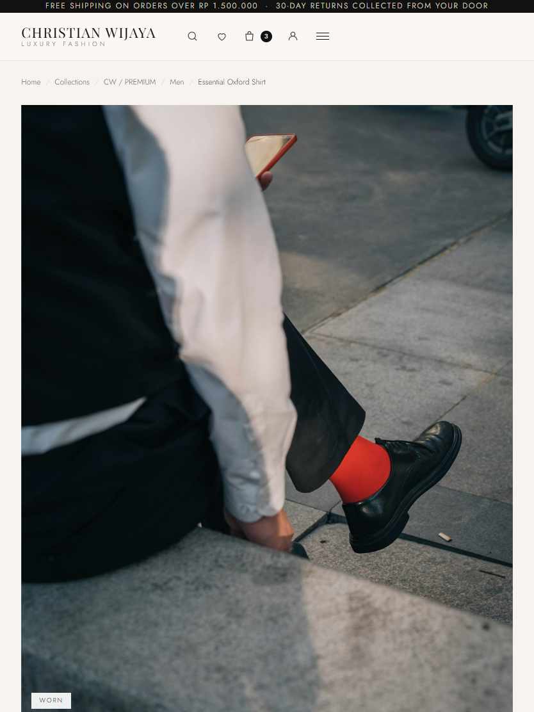 | 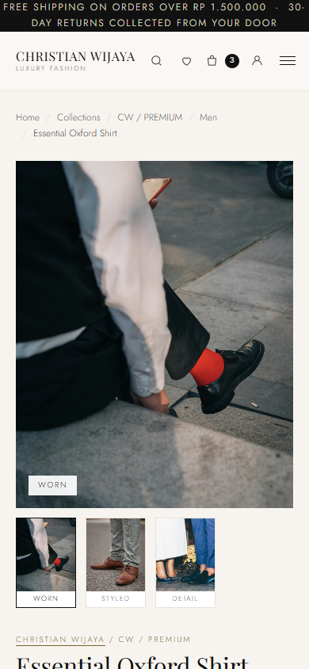 |

### Cart

| Desktop — 1440 × 900 | Mobile — 390 × 844 |
|---|---|
| 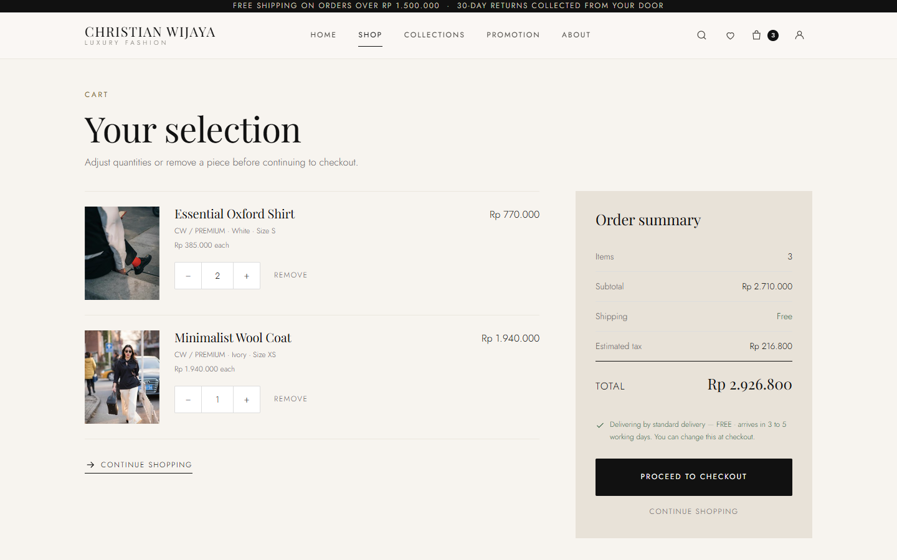 | 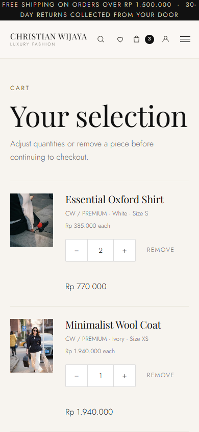 |

### Checkout

| Desktop — 1440 × 900 | Tablet — 834 × 1112 | Mobile — 390 × 844 |
|---|---|---|
| 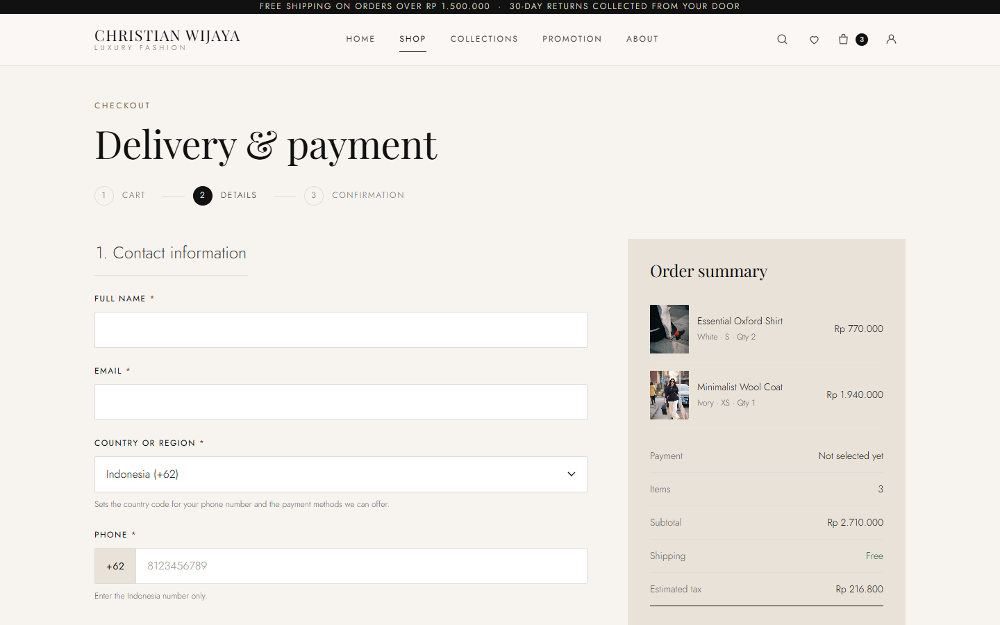 | 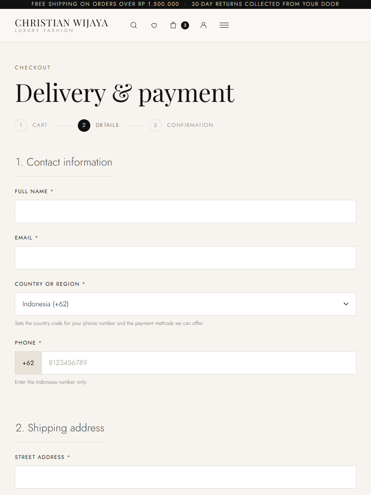 | 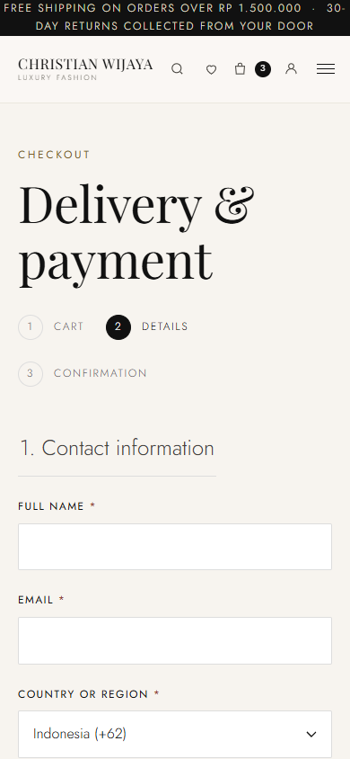 |

> Screenshots currently cover five of the ten pages. About, Collections, Promotion, Wishlist and Order Confirmation are not yet captured.

---

## 3. Project objectives

These are the objectives the build actually delivers. Each one is backed by an executed test in the [QA report](documentation/QA_REPORT.md).

1. Present a **complete shopping journey** across ten pages: Home, Shop, Collections, Product Detail, Cart, Checkout, Order Confirmation, Wishlist, Promotion, About.
2. Organise the catalogue around a **house-and-line brand architecture** rather than treating categories as brands.
3. Price and format money **consistently in Indonesian Rupiah** through a single central formatter.
4. Support **country/region selection with a separate dialling code** and a national-only phone field.
5. Offer **five Indonesian payment methods**, each revealing only its own fields, all simulated.
6. Keep cart state **consistent across every view** — badge, cart page, checkout summary and order totals.
7. Meet **WCAG-oriented accessibility** targets and remain usable from 390 px to 1440 px.

---

## 4. Features

### Catalogue
- **16 products** across four rooms: **Men (5)**, **Women (5)**, **Shoes (3)**, **Accessories (3)**.
- Search by name or colour, plus filters for **category, price (Rp 300.000 – Rp 2.500.000), colour and minimum rating**, and four sort orders (featured, highest rated, price ascending/descending).
- Live product count, a proper empty state when nothing matches, and quick-add from catalogue cards.
- Product pages with gallery, price, size and colour pickers, sold-out sizes marked, star ratings with review counts, delivery promise, product details and a related-products rail.

### Shopping
- **Cart** with quantity stepper (1–10 per line), remove, live order summary and a navbar badge that always agrees with the cart.
- **Wishlist** with an independent badge, toggleable from product cards and product pages.
- Cart and wishlist persist in `localStorage` and survive a page refresh.

### Checkout — three steps (Cart → Details → Confirmation)
- Contact: full name, email, **country or region**, and phone with the dialling code in a **separate chip** and a live *"Will be saved as +62 …"* hint.
- Address: street, city, postcode.
- **Delivery:** Standard (free, 3–5 working days) or Express (Rp 25.000, 1–2 working days). The choice changes the order total.
- **Payment — exactly one panel visible at a time:**

  | Method | What it reveals |
  |---|---|
  | Credit / Debit Card | Card type — **Visa, Mastercard, GPN** — plus cardholder name, number, expiry, security code |
  | Bank Transfer / Virtual Account | 14 Indonesian banks, searchable, with a generated demo account number |
  | QRIS | A drawn demo QR block, labelled as *not* a scannable payment code |
  | Digital Wallet | GoPay, DANA, OVO, LinkAja, with a demo amount and a "continue" step |
  | Cash on Delivery | Pickup area note — Bandung and Jakarta |

- **Order confirmation** with an order number (`CW-2026-XXXXX`), estimated delivery date, total paid, delivery method, a payment record and the ordered items.

### Throughout
- Toast notifications after every action, an `aria-live` region, an accessible auth modal with focus trap, a mobile navigation drawer, a newsletter form, and a skip link.

---

## 5. Pages and navigation

```
CHRISTIAN WIJAYA
├── Home            index.html        hero · featured · brand story · rooms · promotion · craft · journal · newsletter
├── Shop            shop.html         16 pieces · filters · search · sort · quick add
├── Collections     collections.html   house → line → CW / PREMIUM → four rooms → reordered pieces
├── Promotion       promotion.html     4 campaigns (40% / 30% / 25% / 20% off) · gifting · terms
├── About           about.html        the house in Bandung · craft · 3 principles · house statistics
├── Product Detail  product.html?id=  gallery · price · size/colour · rating · delivery · add to cart
├── Wishlist        wishlist.html     saved pieces · toggle · badge
├── Cart            cart.html         line items · qty ± · remove · live summary · checkout CTA
├── Checkout        checkout.html     contact · address · delivery · payment · live order summary
└── Confirmation    confirmation.html order number · ETA · total · delivery · payment · items
```

Global chrome on every page: announcement bar, primary nav, search, wishlist and cart badges, auth modal, toast stack, mobile drawer, and a footer with newsletter and legal links.

> The announcement bar reads **"Free shipping on orders over Rp 1.500.000"**.

---

## 6. Technology stack

| Layer | Choice | Notes |
|---|---|---|
| Markup | **HTML5** | 10 static pages, one file each. Semantic landmarks, `lang`, viewport meta, and a meta description on all 10 |
| Styling | **CSS3** | One stylesheet (~79 KB), entirely driven by custom properties. Flexbox and CSS Grid; no preprocessor |
| Behaviour | **Vanilla JavaScript (ES2015+)** | One script (~121 KB) in an IIFE. No framework, no bundler, no transpiler |
| State | **`localStorage`** | 5 keys: `cw_cart`, `cw_wishlist`, `cw_user`, `cw_shipping`, `cw_last_order` |
| Hosting | **Static** | Any static host. No server-side component |
| Icons | **Inline SVG** | Built in JavaScript. No icon font, no icon library |
| Fonts | **Google Fonts** | Playfair Display (display) and Jost (UI), both SIL Open Font License, with a full local fallback stack |

**Deliberately absent:** React, Vue, Angular, PHP, Node, npm, any backend, any database, any payment gateway, any analytics or tracking script.

---

## 7. Project architecture

### Single source of truth for money

Every price on the site flows through one configuration block and one formatter:

```js
const CONFIG = {
  currency: 'IDR',
  locale: 'id-ID',
  freeShippingThreshold: 1500000,   // Rp 1.500.000
  shippingFlat: 25000,              // Rp 25.000
  taxRate: 0.08
};

const money = (n) => new Intl.NumberFormat(CONFIG.locale, {
  style: 'currency', currency: CONFIG.currency,
  minimumFractionDigits: 0, maximumFractionDigits: 0
}).format(n);
```

Prices are stored as plain integers and formatted **only at render time**. No price symbol or separator is hard-coded anywhere else — which is why the whole site switches currency with a one-line change.

### One cart state

The cart is read from `localStorage`, **normalised on the way in**, and then every consumer — navbar badge, cart page, checkout summary, order totals — reads that same normalised array. Normalisation drops product IDs the catalogue can no longer resolve, clamps quantity to 1–10, and merges lines that resolve to the same variant. This is what removed a class of bug where the badge and the checkout summary could disagree.

### Totals are computed, never hard-coded

```
Subtotal   = Σ (product price × line quantity)
Shipping   = 0 for standard delivery, Rp 25.000 for express
Tax        = round(Subtotal × 0.08)
Total      = Subtotal + Shipping + Tax
```

### Data-driven, not markup-driven

The catalogue, the brand architecture, the country list, the payment sets, the card networks and the bank list are all data arrays in `script.js`. Changing the market or adding a product means editing an array, not a template.

### Page controllers that self-activate

Each controller mounts on the presence of its own element, so every page works independently and can be opened directly.

---

## 8. Folder structure

```
CHRISTIAN-WIJAYA/
├── index.html            Home
├── shop.html             Shop
├── collections.html      Collections / CW / PREMIUM
├── product.html          Product detail
├── cart.html             Cart
├── checkout.html         Checkout
├── confirmation.html     Order confirmation
├── wishlist.html         Wishlist
├── promotion.html        Promotion
├── about.html            About
├── style.css             Design system + all styling
├── script.js             Catalogue, store, page controllers
├── favicon.ico           CW monogram (16 / 32 / 48 px)
│
├── img/
│   └── opt/              Responsive derivatives actually served by the site
│                         (240 / 700 / 1200 / 1920 px)
│
├── screenshots/
│   ├── desktop/          01-home … 05-checkout
│   ├── tablet/           01-home … 05-checkout
│   ├── mobile/           01-home … 05-checkout
│   ├── testing/          favicon-preview.png
│   └── MANIFEST.md       Every capture with size + SHA-256
│
├── documentation/
│   ├── QA_REPORT.md            256 test cases, full results
│   ├── HCI_Report_Outline.md   20-chapter report outline + evidence map
│   ├── usability/              Usability testing instruments (prepared)
│   └── legacy/                 Image extracted from the original HCI.docx
│
├── tests/
│   ├── verify_selectors.py     Bidirectional CSS/markup selector checker
│   ├── _harness.html           Browser test harness
│   └── _a11y.html              Accessibility scan harness
│
└── .gitignore              Rules for the local-only files described below
```

> **Note on `img/`.** The published repository contains **only** `img/opt/` — the responsive derivatives the site actually loads, at 240 / 700 / 1200 / 1920 px. Every one of them is referenced by the catalogue; there are no unused images in the published set.

> **Note on the local working copy.** The full-resolution source photography, the original `HCI.docx`, and the two preserved backup directories are **kept in the local project but excluded from the published repository** via `.gitignore`. Excluding a file from Git does not delete it locally. They remain available for editing and rollback, and nothing the website needs is excluded.

---

## 9. Installation and local setup

**Requirements:** a modern browser and Python 3 (or any static file server). There is nothing to install — no `npm install`, no build, no dependencies.

```bash
# from the project root
python -m http.server 8765
```

Then open **http://127.0.0.1:8765/index.html**.

> **A server is required.** Opening `index.html` directly from the filesystem (`file://`) breaks `localStorage` in some browsers, so the cart and wishlist will not persist. Always serve over HTTP.

### Optional — run the selector checker

```bash
python tests/verify_selectors.py
```

This cross-checks CSS class and ID selectors against the markup in every page and in `script.js`, and reports dead CSS, unstyled markup, missing IDs, brace balance, duplicate tokens and stray inline styles.

### Optional — browser harnesses

- `tests/_harness.html` — drives the real pages and asserts behaviour (cart, checkout, payments, auth, wishlist).
- `tests/_a11y.html` — accessibility scan across the site.

Both expect the site to be served from the project root.

### Browser support

Developed and verified against **Google Chrome 157**. The site uses broadly supported CSS (Grid, Flexbox, custom properties) and ES2015+ JavaScript, so current versions of Firefox, Safari and Edge are expected to work, but only Chrome 157 was actually tested.

---

## 10. Testing and quality assurance

The site was verified with **256 automated test cases across two suites, plus a documented usability-testing preparation stage**. The two suites are reported separately below, because they measure different things.

### Suite A — Functional behaviour · 125 cases

The real pages are served over HTTP and driven in a headless DOM, with `localStorage` seeded *before* the page scripts run so each page boots exactly as a returning visitor's would.

| Group | Cases | Result |
|---|---|---|
| Navigation | 4 | 4 PASS |
| Product catalogue | 13 | 13 PASS |
| Cart | 16 | 16 PASS |
| Checkout | 51 | 51 PASS |
| Auth & wishlist | 26 | 26 PASS |
| Responsive (static analysis) | 9 | 7 PASS · **2 BLOCKED** |
| Accessibility & technical | 6 | 6 PASS |
| **Total** | **125** | **123 PASS · 0 FAIL · 2 BLOCKED** |

**The two blocked cases** were *desktop/tablet/mobile visual layout* and *horizontal overflow in a live viewport*. They were blocked because no browser was attached to that particular run — a headless DOM performs no layout. **Both were subsequently executed and passed** in the real-browser suite below. They remain recorded as `BLOCKED` in the Suite A table on purpose: the historical result was not rewritten.

### Suite B — Real-browser responsive verification · 131 cases

Driven with **Google Chrome 157 over the DevTools Protocol**, so every figure below is a measurement rather than an inference from CSS.

| Result | Count |
|---|---|
| **PASS** | **131** |
| **FAIL** | **0** |
| **BLOCKED** | **0** |

**Viewports:** 1440 × 900 (desktop) · 834 × 1112 (tablet) · 390 × 844 (mobile)
**Pages at every viewport:** Home, Shop, Product Detail, Cart, Checkout — 5 × 3 = 15 combinations

What was measured: `scrollWidth` against `clientWidth`; every element rectangle against the viewport; `scrollWidth` against `clientWidth` on every clipped-overflow element; pairwise intersection of every content block; image rendered size, zero-size images and viewport-wider images; navigation state per viewport; **effective tap area probed with `elementFromPoint()`**; checkout input heights and radio-card targets; console errors and failed requests.

**Headline results:** zero horizontal overflow at any viewport on any page · zero elements past the viewport · zero clipped text · zero overlapping blocks · all images rendering at a usable size · navigation adapting correctly (full nav on desktop, hamburger on tablet and mobile) · zero console errors.

### Bugs found and fixed during testing

| # | Bug | Root cause | Fix |
|---|---|---|---|
| **BUG-1** | Expanding *"View all banks"* in the Bank Transfer panel showed **20 bank cards for a 14-bank catalogue** — the 6 popular banks were listed twice | The expanded grid was filled with the entire bank array instead of only the banks not already shown in the popular grid | Render only the remainder; now 6 + 8 = 14 cards, 0 duplicates |
| **BUG-2** | Several interactive controls rendered **under 24 px tall**, below WCAG 2.2 SC 2.5.8 (footer links 19.8 px, "Continue shopping" 20.8 px, cart "Remove" 22.8 px, section-head links 23.8 px) | Line-height-driven link and button styling with no minimum hit area | A pseudo-element expands the clickable region without moving a single visible pixel; verified with `elementFromPoint()` probing 6 px above and below each control, and checked for collisions between expanded targets |

### Also confirmed by the suites

- Cart badge, cart page, checkout summary and order totals all agree — verified for single-product, multi-product, quantity-change, removal, page-refresh and stale-catalogue-id carts.
- `Total = Subtotal + Shipping + Tax` is always computed by the application. Express delivery raises the total by exactly Rp 25.000 and leaves tax unchanged.
- No `$` or `USD` appears on any of the ten pages.
- **Card numbers and security codes are never written to storage.** The persisted order record contains only the payment method, the card network, and a mock virtual-account number using deliberately fictional bank prefixes.
- Exactly one payment panel is visible at a time.
- Zero broken internal links, zero missing image files, zero unlabelled form controls, zero images without an `alt` attribute, and a clean console on all ten pages.

### Full documentation

The complete case-by-case log — every test with its expected result, actual result and status — is in **[`documentation/QA_REPORT.md`](documentation/QA_REPORT.md)**.

### Usability testing — prepared, not yet conducted

A complete usability-testing package has been prepared in [`documentation/usability/`](documentation/usability/):

| File | Contents |
|---|---|
| `participant_information.md` | Anonymous ID system (P01–P05), intake form, recruitment criteria, and an explicit list of what is **not** collected |
| `consent_template.md` | Plain-language consent form |
| `moderator_script.md` | Verbatim opening and closing scripts, think-aloud protocol, assistance ladder, session setup |
| `usability_tasks.md` | Eight tasks with success / partial / failed criteria and the exact on-screen wording |
| `observation_sheet.md` | Per-task capture form and session summary |
| `post_test_questionnaire.md` | Eight 1–5 Likert items, three open questions, interview prompts |
| `results_template.csv` | Raw-data and aggregate templates with every calculation formula documented |

> **No participant sessions have been run yet, and there are no usability results.** Every result field in these instruments is intentionally blank. The automated QA above demonstrates that the interface *behaves* correctly; it says nothing about whether a first-time visitor can use it comfortably. That evaluation is still outstanding.

---

## 11. Responsive testing evidence

The layout is built on six width breakpoints and verified at three viewports in a real browser.

| Viewport | Breakpoint behaviour | Evidence |
|---|---|---|
| **Desktop** 1440 × 900 | Full primary navigation; shop filters in a left column; cart and checkout keep a sticky summary column (380 px / 400 px) | [`screenshots/desktop/`](screenshots/desktop/) |
| **Tablet** 834 × 1112 | Primary navigation collapses to a hamburger; the shop filter rail collapses to a single column and the filter controls move behind a "Filters" button; `.cart-layout` and `.checkout-layout` collapse to one column | [`screenshots/tablet/`](screenshots/tablet/) |
| **Mobile** 390 × 844 | Single column throughout; the phone field's dialling-code chip stacks above the number input so the number field stays comfortably tappable; the QR demo block shrinks to 168 px | [`screenshots/mobile/`](screenshots/mobile/) |

Additional behaviour verified in the browser:

- **Zero horizontal overflow** at 390, 834 and 1440 px on every tested page — content reflows rather than scrolling sideways.
- **Touch targets** meet the 24 × 24 CSS px minimum after the BUG-2 fix; shipping and payment radio cards measure **79 px** tall, and checkout text inputs are 40 px or more.
- `prefers-reduced-motion` is honoured, and a print stylesheet produces a clean order receipt.

---

## 12. Known limitations

Stated plainly, because a portfolio that hides its limits is worth less.

**Functional**
- **Payment is entirely simulated.** No gateway, no transaction, no card data stored or transmitted.
- **No backend.** Cart, wishlist, session and order history live in the visitor's own browser. Clearing site data clears the cart, and the order history is not retrievable on another device or after a cache clear.
- **No account system.** The login and sign-up forms are front-end demonstrations; no credentials are verified, hashed, stored, or transmitted.
- **No real product inventory.** Stock is not tracked, and the catalogue is a fixed array.
- **The virtual-account numbers are fictional**, generated from deliberately non-real 3-digit bank prefixes so they cannot be mistaken for live instructions.

**Verification**
- **Only Chrome 157 was actually tested.** Firefox, Safari and Edge are expected to work but were not verified.
- **No screen-reader pass and no formal automated accessibility audit** (axe, Lighthouse, WAVE) has been performed. Semantics, labelling, focus management and contrast were checked by hand and by script.
- **No real-device testing.** Tap areas are measured and compliant, but thumb comfort on physical hardware has not been assessed.
- **No usability testing has been conducted.** The instruments exist; the sessions have not happened.

**Content and assets**
- Screenshots currently cover five of the ten pages.
- Photography credits are **not yet verified** — see [section 14](#14-image-and-font-credits).
- The published repository contains only the responsive image derivatives the site loads. The full-resolution source photography, the original `HCI.docx`, and the two preserved backup directories are kept in the local working copy and excluded via `.gitignore`.

**Code**
- Two unused CSS selectors remain (`.on-dark`, `.split--flip`).
- A vestigial, permanently hidden payment panel for a method that is not offered in Indonesia remains in `checkout.html`.
- The auth handlers read form fields through the raw `HTMLFormElement` named getter rather than the project's own field helper. It works, but it is less resilient than the rest of the codebase.

---

## 13. Payment simulation disclaimer

> ### ⚠️ Payment options are simulated
>
> **No real transaction can occur in this project, and none is attempted.**
>
> - **No real payment gateway is integrated.** There is no network call to any payment provider, no merchant account, no API key, and no third-party payment script anywhere in the codebase.
> - **No money moves.** Selecting a method and placing an order writes a summary to the visitor's own browser and redirects to a confirmation page. That is the entire mechanism.
> - **The QR code is not a real scannable payment QR.** The QRIS panel renders a decorative grid drawn with CSS to illustrate the shape of a QR code. It is explicitly labelled in the interface as *"This QR is drawn for the prototype only. It is not a real QRIS code and cannot be scanned."*
> - **Virtual account numbers are fictional.** They are generated from made-up 3-digit bank prefixes so they are obviously not real transfer instructions.
> - **Card details are never persisted.** The card number and security code are used only for client-side form validation and are never written to `localStorage` or sent anywhere. The stored order record keeps only the method, the card network, and — for bank transfer — a mock account number.
> - **This is a front-end demonstration project**, built for a Human–Computer Interaction assignment to demonstrate interface design, information architecture, and the checkout flow. It is not a functioning shop and must not be used to take payments.

---

## 14. Image and font credits

### Photography

All product and editorial photography is from **[Unsplash](https://unsplash.com)**, used under the **Unsplash Licence**, which permits free use — including commercial use — **without requiring attribution**. Crediting the photographers is still the right thing to do, and the credit list is included below for that purpose.

> ### ⚠️ These credits are not yet verified
>
> The table lists the **Unsplash account slug and photo ID as recorded in the source filenames**, which is where the only attribution data in this project lives — the image files themselves contain no EXIF or XMP attribution metadata, and the site contains no `unsplash.com` reference at all.
>
> The photo URLs below follow Unsplash's canonical `unsplash.com/photos/<id>` form, but **they could not be machine-verified from the build environment** (Unsplash returns HTTP 403 to automated requests). The account slugs for three sources — `glassesshop`, `kier-in-sight-archives` and `personalgraphic-com` — look like organisation or collection accounts rather than individual photographers.
>
> **Each row must be confirmed by hand before publication.** Open the URL and check it resolves to the intended photograph and photographer.

#### The 18 photographs used by the catalogue

| # | Unsplash account slug | Photo ID | Photo URL — *to verify* |
|---|---|---|---|
| 1 | `alex-shaw` | `GcA8PoYjKB0` | `https://unsplash.com/photos/GcA8PoYjKB0` |
| 2 | `alex-shaw` | `GrxqPNpMK40` | `https://unsplash.com/photos/GrxqPNpMK40` |
| 3 | `alexander-naglestad` | `RFhq0SrrgEg` | `https://unsplash.com/photos/RFhq0SrrgEg` |
| 4 | `azamat-zhanisov` | `oghf91mQ0-Q` | `https://unsplash.com/photos/oghf91mQ0-Q` |
| 5 | `bruchin-noeka` | `N9G5GL9VewE` | `https://unsplash.com/photos/N9G5GL9VewE` |
| 6 | `davinder-singh` | `2nST4hbvTkc` | `https://unsplash.com/photos/2nST4hbvTkc` |
| 7 | `eric-fung` | `Z0GZrpwcc5Y` | `https://unsplash.com/photos/Z0GZrpwcc5Y` |
| 8 | `glassesshop` | `u3o3O67mrJo` | `https://unsplash.com/photos/u3o3O67mrJo` |
| 9 | `ivan-kazlouskij` | `GT19NqJySFA` | `https://unsplash.com/photos/GT19NqJySFA` |
| 10 | `joel-zar` | `jrOuxQ9iRlM` | `https://unsplash.com/photos/jrOuxQ9iRlM` |
| 11 | `kier-in-sight-archives` | `R0mbwH2wxj0` | `https://unsplash.com/photos/R0mbwH2wxj0` |
| 12 | `marcus-lewis` | `wGuQH9JPcEY` | `https://unsplash.com/photos/wGuQH9JPcEY` |
| 13 | `mohamad-khosravi` | `VSZLQcc4LSw` | `https://unsplash.com/photos/VSZLQcc4LSw` |
| 14 | `nikita-kachanovsky` | `ad_0wMHtvlU` | `https://unsplash.com/photos/ad_0wMHtvlU` |
| 15 | `personalgraphic-com` | `zxPo13geJ5U` | `https://unsplash.com/photos/zxPo13geJ5U` |
| 16 | `raoul-croes` | `94KcLYsihLY` | `https://unsplash.com/photos/94KcLYsihLY` |
| 17 | `segal-jewelry` | `NsH-CvU0deg` | `https://unsplash.com/photos/NsH-CvU0deg` |
| 18 | `zhouxing-lu` | `1fdni7Dkfs8` | `https://unsplash.com/photos/1fdni7Dkfs8` |

#### Additional source images

The repository also contains **49 further Unsplash source photographs** that are not referenced by the catalogue. They follow the identical `<account-slug>-<photo-id>-unsplash.jpg` naming convention, so the same procedure applies. If they are excluded from the published repository, they need no credits; if they are published, they must be credited too.

#### Unsplash search collections recorded in the original project document

The original `HCI.docx` recorded three Unsplash search collections as its reference list. These are project references rather than per-image credits:

- `https://unsplash.com/s/photos/luxury-fashion`
- `https://unsplash.com/s/photos/luxury`
- `https://unsplash.com/s/photos/handbag`

### Typefaces

| Typeface | Use | Licence |
|---|---|---|
| **Playfair Display** | Display and headings | SIL Open Font License 1.1 — loaded from Google Fonts |
| **Jost** | Body copy, UI and labels | SIL Open Font License 1.1 — loaded from Google Fonts |

Both are served from Google Fonts with a complete local fallback stack (Didot, Bodoni MT, Hoefler Text / Futura, Helvetica Neue, Arial), so the site degrades gracefully without the CDN.

### Other assets

- **Icons** — all inline SVG authored in `script.js`. No icon font or third-party icon library.
- **QRIS panel** — drawn with CSS grid cells, not an image and not a real QR code.
- **Favicon** — generated locally as a CW monogram at 16, 32 and 48 px.
- **No third-party libraries of any kind** are bundled, vendored, or loaded, other than Google Fonts.

---

## 15. Future improvements

**Testing and evaluation**
1. Run the prepared usability sessions and publish the results — this is the biggest outstanding gap.
2. Complete the photography credit verification.
3. Add a formal automated accessibility audit (axe, Lighthouse, WAVE) and record the score.
4. Run a screen-reader pass and a keyboard-only walkthrough.
5. Verify in Firefox, Safari and Edge, and on real devices.

**Product**
6. A real payment gateway integration — the actual path from prototype to production.
7. A real account backend behind the session, with secure authentication.
8. Order history, returns, and a tracking timeline.
9. Indonesian/English language switching — the copy is already region-aware.
10. A small editorial section with real catalogue content.

**Engineering**
11. Remove the two dead CSS selectors and the vestigial payment panel.
12. Move the auth handlers onto the project's existing field helper.
13. Add a favicon `<link>` declaration to each page so the icon resolves correctly on GitHub Pages project subpaths, plus canonical and Open Graph tags for link sharing.
14. Self-host the two typefaces to remove the external font request.
15. Optional: a small build step for image optimisation and CSS minification.

---

## 16. License status

> **No licence has been selected for this project yet.**
>
> A `LICENSE` file is **not** included in the repository at this stage. Until one is added, the project is **all rights reserved** by default — nobody may legally reuse, fork, modify or redistribute the code or assets.
>
> Adding a licence is part of the final publication step. `MIT` is the conventional choice for portfolio work of this kind, but the decision belongs to the author and may be constrained by institutional requirements.

Third-party components carry their own terms: the photographs are under the **Unsplash Licence**, and **Playfair Display** and **Jost** are under the **SIL Open Font License 1.1**.

---

## 17. Author information

> **To be completed by the author before publication.**

| | |
|---|---|
| **Author** | *[Your name]* |
| **Role** | *[e.g. Student, Human–Computer Interaction — BINUS]* |
| **Institution** | *[Your university]* |
| **Course / Assignment** | *[Course code and assignment title]* |
| **Email** | *[your.university.email@example.com]* |
| **LinkedIn** | *[linkedin.com/in/your-handle]* |
| **GitHub** | *[github.com/your-handle]* |
| **Portfolio** | *[your portfolio URL]* |
| **Live Demo** | *[Live Demo — Coming Soon]* |

### Project context

| | |
|---|---|
| **Project type** | Human–Computer Interaction coursework — design, implementation and evaluation |
| **Version** | V0.2 |
| **Development period** | October – November 2026 |
| **Language** | HTML5 · CSS3 · Vanilla JavaScript |

---

<div align="center">

**CHRISTIAN WIJAYA** · CW / PREMIUM
*Made in Bandung · 2016*

</div>
